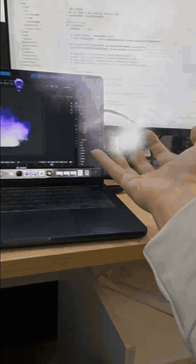

# Blender + Android AR · Refine Bone Spirit Cold Flame to Foundation Establishment

[简体中文](README.md)



This project plays a 15-second violet flame made in Blender and displays it in the real world on an ARCore Android device. The source scene includes the flame material, camera and gas simulation settings.

## How it works

```text
Blender timeline → transparent PNG → FastAPI → WebSocket → Android ARCore anchor
```

The Blender script selects the matching pre-rendered frame when you play or scrub the timeline. FastAPI forwards the latest frame to connected devices, and Android updates a camera-facing transparent plane attached to an AR anchor. Pausing the timeline leaves the latest frame visible.

## Requirements

- Blender on macOS and Python 3.10 or later. The server script creates a virtual environment and installs dependencies on first run.
- JDK 17, Android SDK Platform 37 and `adb` to build and install the debug app.
- An ARCore-compatible Android device with Google Play Services for AR and camera permission.

## Run the demo

1. From the project root, run `./scripts/start_server.sh`. Keep the terminal open and note the displayed pairing code.
2. Launch Blender with the publisher script, substituting the pairing code, then press Play in the timeline.

   ```sh
   PAIRING_CODE=YOUR_CODE /Applications/Blender.app/Contents/MacOS/Blender \
     blender/scenes/violet_fire_ar.blend --python blender/live_smoke.py
   ```

3. Build and install the debug app.

   ```sh
   ./scripts/build_android.sh
   adb install -r android/app/build/outputs/apk/debug/app-debug.apk
   ```

4. For USB, run `adb reverse tcp:8000 tcp:8000` and use `localhost` in the app. For Wi-Fi, put the phone and Mac on the same network, replace `localhost` with the Mac's LAN IP in the [debug network configuration](android/app/src/debug/res/xml/blenderar_debug_network.xml), then rebuild and reinstall. Use the same IP in the app. The default port is `8000`.
5. Enter the pairing code and connect. Open the AR view, select **Blender 紫焰** (Blender Violet Flame) and tap **放置特效** (Place Effect).

## Source files and rendering

| Path | Contents |
| --- | --- |
| [violet_fire_ar.blend](blender/scenes/violet_fire_ar.blend) | Editable Blender scene |
| `blender/scenes/preview/violet_fire_ar/` | 270 transparent 480×480 PNGs, frames 55–324 at 18 fps |
| `server/` | FastAPI service, pairing and frame relay |
| `android/` | Kotlin, Compose, SceneView and ARCore client |
| `scripts/` | Server and Android build entry points |

The included PNG sequence is sufficient for the AR demo. To view or re-render the Blender volume, place the original `fluid_smoke_cache` beside the scene. The cache is approximately 5.6 GB and is excluded from Git. The Android UI currently uses Chinese labels.

## Troubleshooting

- **Connected, but no flame:** Start Blender playback, enter the AR view, point at a surface and place the effect.
- **WebSocket 403:** Use the pairing code shown in the current server terminal. It can change on restart.
- **Cleartext blocked:** Check that the debug build allows the exact host you entered, then rebuild and reinstall.
- **Flat appearance from another angle:** The phone uses a camera-facing plane. Blender performs the volume simulation and rendering.

## Verify the build

```sh
cd android
./gradlew :app:assembleDebug :app:testDebugUnitTest
```

## License

This project is licensed under the [MIT License](LICENSE).
