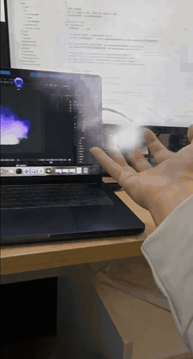

# Blender + Android AR 炼化骨灵冷火到筑基

[English](README.en.md)



Blender 播放 15 秒紫焰动画时，Python 脚本跟随时间轴，将对应的透明 PNG 帧发送到本机 FastAPI 服务。Android 通过 WebSocket 接收这些帧，在 ARCore 锚点上更新朝向摄像头的透明贴片。

## 工作原理

```text
Blender 时间轴 → 480×480 透明 PNG → FastAPI → WebSocket → Android ARCore 锚点
```

播放或拖动 Blender 时间轴时，发送脚本读取对应帧。服务端向订阅设备转发最新帧，手机把它更新到面向摄像头的贴片上。暂停播放时保留最后一帧。动画共 270 帧，以 18 fps 播放 15 秒。

## 环境准备

- Mac 上安装 Blender 和 Python 3.10 或更新版本。首次启动服务会创建虚拟环境并安装依赖。
- Android 构建需要 JDK 17、Android SDK Platform 37 和 `adb`。用 Android Studio 打开 `android/` 也可以构建。
- 手机须支持 ARCore，并安装 Google Play Services for AR。首次进入 AR 时允许使用摄像头。

## 运行

1. 在项目根目录运行 `./scripts/start_server.sh`。终端会显示配对码与局域网地址。
2. 在 Blender 播放紫焰。Mac 示例命令如下，将环境变量设为终端显示的配对码。

   ```sh
   PAIRING_CODE=你的配对码 /Applications/Blender.app/Contents/MacOS/Blender \
     blender/scenes/violet_fire_ar.blend --python blender/live_smoke.py
   ```

3. 用 JDK 17 和 Android SDK Platform 37 运行 `./scripts/build_android.sh`，在支持 ARCore 的真机上安装生成的调试 APK。
4. USB 调试时运行 `adb reverse tcp:8000 tcp:8000`，App 服务器 IP 填 `localhost`。Wi-Fi 调试时，将调试版网络配置中的 `localhost` 改成 Mac 的局域网 IP 后重建 APK，在手机中填写相同的 IP。端口默认是 `8000`。
5. 手机连接后进入 AR，选择「Blender 紫焰」，然后点「放置特效」。

## 目录

| 路径 | 内容 |
| --- | --- |
| `blender/` | 紫焰场景、透明帧和时间轴推送脚本 |
| `server/` | FastAPI、配对和 WebSocket 帧转发 |
| `android/` | Kotlin、Compose、SceneView 和 ARCore 客户端 |
| `scripts/` | 启动服务和构建 APK |
| `docs/` | 真机演示动图 |

## Blender 与素材

- [violet_fire_ar.blend](blender/scenes/violet_fire_ar.blend) 是唯一发布场景。包含紫焰材质、相机和气体域设置。
- `blender/scenes/preview/violet_fire_ar/` 包含帧 55–324，共 270 张 480×480 RGBA 帧，18 fps。即使没有 VDB 缓存，也可以播放时间轴并推送这些帧。
- 在 Blender 视口查看体积或重新渲染，需要把原始 `fluid_smoke_cache` 放到场景同级。该缓存约 5.6 GB，默认排除在 Git 之外。
- 局域网调试 APK 只允许配置中指定的明文主机。控制台通过 Mac 上的 `http://localhost:8000/` 打开。

## 常见问题

- **App 已连接但没看到紫焰**。先确认 Blender 正在播放，进入 AR 后对准地面或桌面，点击「放置特效」。
- **WebSocket 返回 403**。核对服务端终端显示的配对码。服务重启后可能生成新码。
- **提示 CLEARTEXT**。Wi-Fi 模式下，检查 [调试网络配置](android/app/src/debug/res/xml/blenderar_debug_network.xml) 是否允许当前 Mac IP，并确认已安装重建后的 APK。
- **换角度时像贴片**。当前手机端以带透明度的相机朝向贴片显示预渲染画面，流体模拟和材质渲染在 Blender 中完成。

## 验证

```sh
cd android
./gradlew :app:assembleDebug :app:testDebugUnitTest
```

## 许可证

本项目采用 [MIT 许可证](LICENSE)。
